[EN](README.md) | **ES**

# Ecorex — Colecciona emociones con forma de dinosaurio
### Juego PWA de descubrimiento y colección | React · TypeScript · Cloudflare Pages/D1 · Web Push

[](https://ecorex-project.pages.dev)
[](https://github.com/SamBarrado/EcoRex/releases)
[](https://github.com/SamBarrado/EcoRex/commits/main)

<p align="center">
  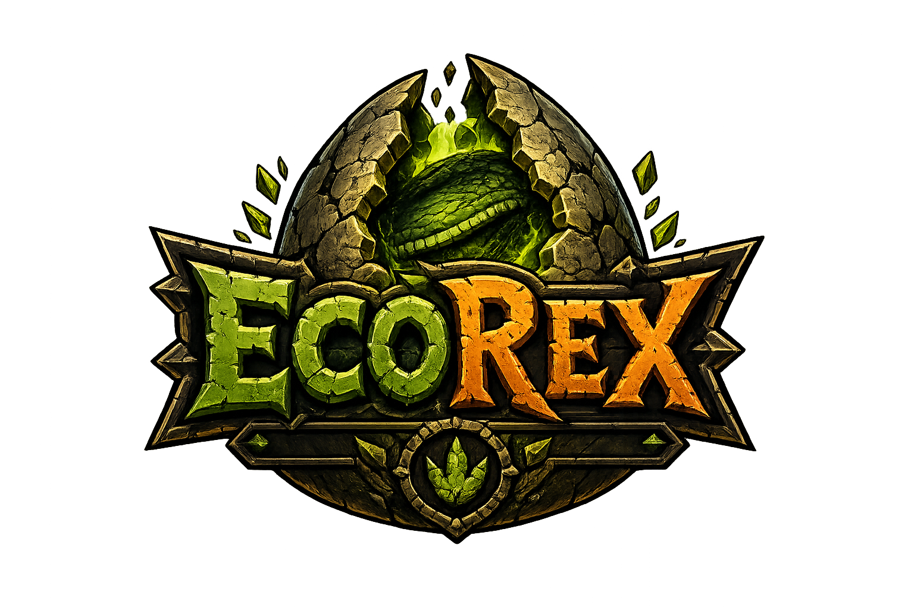
</p>

Ecorex es un juego web instalable (PWA) donde el jugador **percibe** dinosaurios que son, en realidad, el cuerpo que toman ocho emociones primarias atrapadas desde la extinción. Cada descubrimiento es una **carta coleccionable** con su especie, su emoción (*Fractae*), su rareza y su fase; las cartas repetidas se **fusionan** en el Altar para obtener la versión desbordada de la criatura, y todo suma XP, niveles y misiones diarias.

<table>
  <tr>
    <td align="center">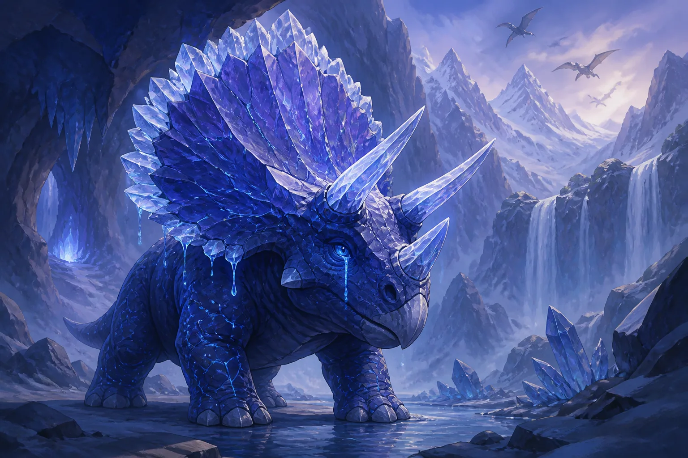<br><b>Balance</b> — forma estable</td>
    <td align="center">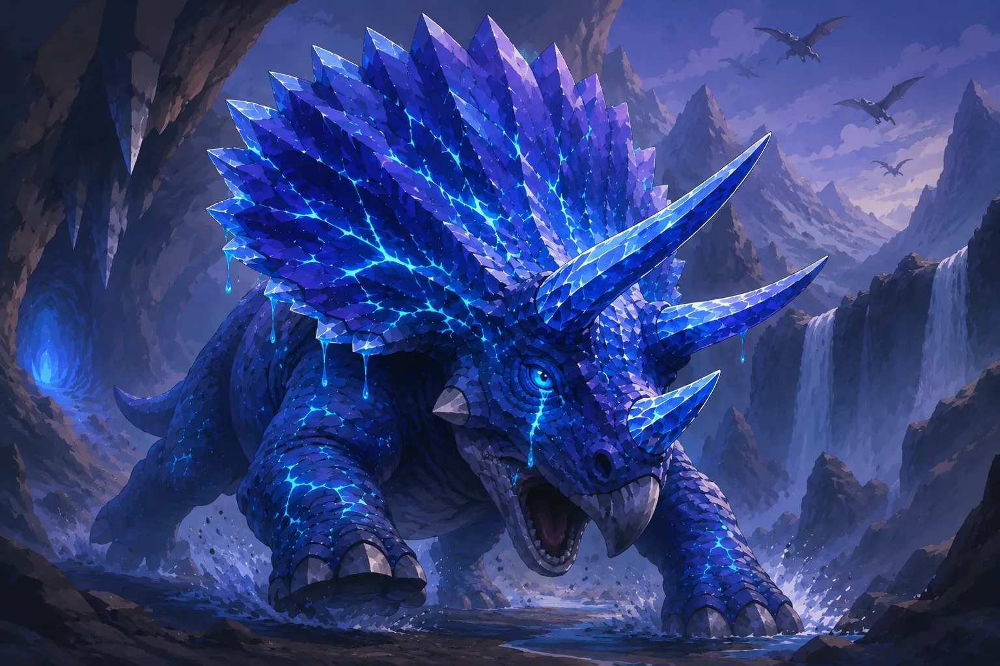<br><b>Exceso</b> — forma desbordada</td>
    <td align="center">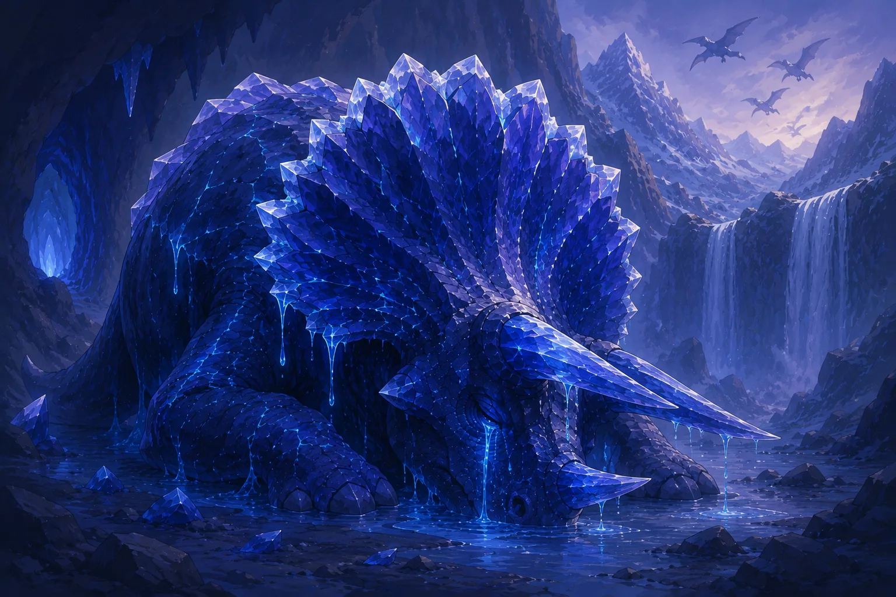<br><b>Eco</b> — versión tenue</td>
  </tr>
</table>

*Las tres fases de una misma especie: **Triceratops umbra**, «Tricera de las Lágrimas» (Fractae Tristeza).*

**Jugar:** [ecorex-project.pages.dev](https://ecorex-project.pages.dev)

Este README documenta el proyecto como un **caso de estudio de producto e ingeniería**: qué se ha construido, qué problemas reales han aparecido por el camino y por qué se tomó cada decisión de diseño, con el nivel de detalle que necesitaría alguien que coge este código en frío.

---

## 🚀 Inicio rápido

```bash
git clone https://github.com/SamBarrado/EcoRex.git
cd EcoRex
npm install
cp .dev.vars.example .dev.vars   # y rellena tus propias claves (no van en el repo)
npx wrangler d1 execute DB --local --file=schema.sql   # crea las tablas en la D1 local
npm run db:seed                                        # siembra rarezas, Fractae y especies
npm run dev                      # build + wrangler pages dev: frontend + Functions + D1/KV locales
```

`npm run vite:dev` levanta solo el frontend: las pantallas funcionan, pero cualquier cosa que toque cuentas, colección o energía necesita las Functions y la D1 local. Para la guía completa (y para desplegar tu propia copia) ve a «⚙️ Ejecutarlo en local» más abajo.

---

## 💡 De dónde viene la idea

Ecorex nace de un prototipo anterior, [Dino Discovery](https://github.com/SamBarrado/DinoDiscovery): una app donde un niño inventa su dinosaurio eligiendo atributos y recibe una carta generada por IA. De ahí salió la idea de que lo valioso no era «generar una imagen», sino **encontrar un objeto coleccionable**. Ecorex lleva esa idea a un juego persistente, con cuentas, catálogo fijo de especies y progresión, y reutiliza de aquel prototipo la capa de infraestructura ya probada (rate limiting, caché, R2, validación de origen).

La premisa narrativa es lo que distingue a Ecorex:

> Hace 66 millones de años, el impacto que extinguió a los dinosaurios generó la mayor descarga de trauma emocional colectivo de la historia del planeta. Esa emoción no se disipó: quedó atrapada, fragmentada, dormida — como fósiles, pero emocionales. Algo reciente ha vuelto a agrietar esa barrera.

Los **Fractae** son esas emociones puras. No son criaturas por sí mismos: necesitan un portador, y el único portador es el dinosaurio. El jugador no es un científico, sino alguien con la sensibilidad de **percibir** lo que los demás no ven.

<p align="center">
  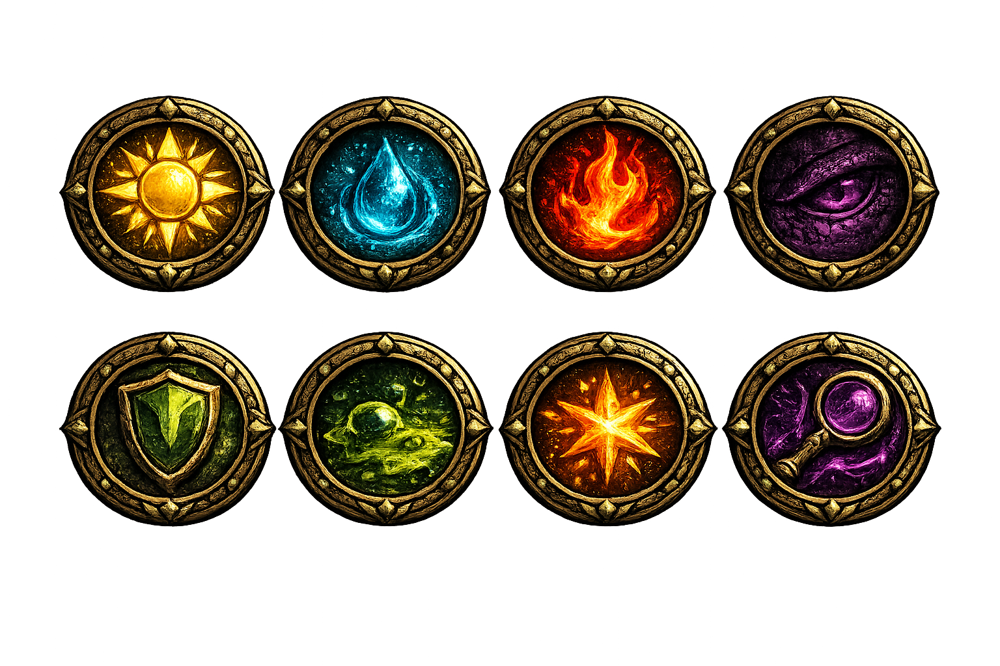
</p>

Ocho Fractae (Alegría, Tristeza, Furia, Miedo, Confianza, Asco, Sorpresa, Curiosidad), organizados en cuatro oposiciones. El diseño completo del universo está en [docs/lore_world_bible_ecorex_v5.md](docs/lore_world_bible_ecorex_v5.md).

---

## 🧒 Para quién es

Para niños que disfrutan con los dinosaurios y los juegos de cartas tipo Pokémon. Una decisión de diseño cerrada pronto: **el usuario de la cuenta es el propio niño**, no un tutor que la gestiona en su nombre (registro directo, sin capa de perfil «padre/hijo»), y el mito fundacional está escrito para que funcione tal cual desde los 5 años, sin suavizarlo. El tono es el de coleccionar y descubrir, no el de generar.

---

## 🎮 Cómo se juega

| Sistema | Qué hace |
|---|---|
| **Percibir** | El ritual de descubrimiento: un sobre a pantalla completa que se rasga arrastrando por la costura, con vibración háptica donde el dispositivo lo permite. Sortea la rareza de la carta de forma independiente de la especie y de la fase. |
| **Energía** | Percibir consume energía, visible en la navegación. Base de 3, se regenera **+1 cada 4 h**, y sube con el nivel (+1 en el 5 y +1 en el 30). Sustituyó a un rate-limit silencioso por IP. |
| **EcoDex** | La colección: cada especie tiene 3 fases (Balance, Exceso, Eco) y las fases ya descubiertas se muestran como cartas completas a escala reducida, con visor a pantalla completa. |
| **Altar de Fusión** | 5 cartas repetidas de una especie en fase Balance se consumen para obtener su carta en fase **Exceso** (4 a partir del nivel 15). No cuesta energía. |
| **Rareza** | Cinco niveles — Común, Poco común, Rara, Épica, Legendaria — con pesos de sorteo 55 / 27 / 12 / 5 / 1 %. Es un eje independiente de la fase. |
| **XP y niveles** | Niveles 1–50 por XP acumulado. Solo da XP lo nuevo (especie+fase vista por primera vez, fusiones, completar las 3 fases de una especie): repetir no da nada. Ocho títulos cosméticos, de «Explorador Novato» a «Voz de la Fractura». |
| **Misiones diarias** | Tres misiones fijas (Percibir ×2, Coleccionista, Fusión) más un bonus por completarlas todas el mismo día. |
| **Notificaciones** | Bandeja in-app con badges en la navegación, y **Web Push** (funciona con la PWA cerrada) cada vez que se regenera un punto de energía. |

<p align="center">
  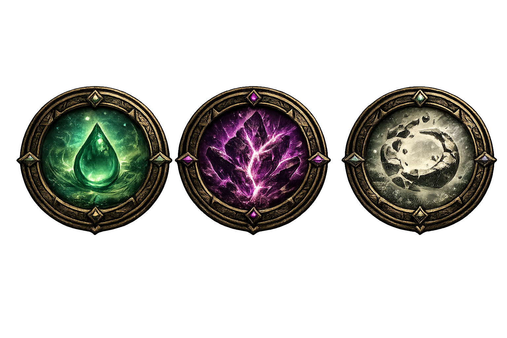
</p>

---

## 🛠️ Herramientas y tecnologías

| Capa | Elección | Por qué |
|---|---|---|
| **Frontend** | React 19 + React Router 7 + TypeScript + Vite | Ciclo de desarrollo rápido y tipos compartidos con el backend |
| **PWA** | `vite-plugin-pwa` (`injectManifest`) + service worker propio | Instalable en móvil sin pasar por tienda; el SW propio gestiona los eventos push. Si algún día hace falta tienda, la vía es envolver la misma build con Capacitor |
| **Backend** | Cloudflare Pages Functions (`functions/api/**`) | Se despliega junto al frontend, sin otro host de API que mantener |
| **Base de datos** | Cloudflare D1 (SQLite) — esquema en [schema.sql](schema.sql) | Datos relacionales (usuarios, colección, misiones, notificaciones) sin servidor de BD que operar |
| **Storage / caché** | R2 (imágenes de especies) + KV (rate limit) | Serverless y gratuito al volumen actual |
| **Push** | Web Push (VAPID) con `@block65/webcrypto-web-push` + un **Worker independiente con Cron Trigger** (`workers/push-cron`) | Las Pages Functions no soportan Cron Triggers |
| **Generación de contenido** | APIs de Anthropic y OpenAI (fichas-spec de especies; variantes y fases de arte) | Pipeline de producción de contenido, ver «Pipeline de arte» |
| **Tests** | Vitest + Testing Library + jsdom | Misma herramienta para componentes, funciones de la API y el Worker |
| **Despliegue** | Cloudflare Pages conectado a GitHub | Cada push a `main` construye y despliega a producción |

---

## 🐛 Problemas técnicos resueltos

No es una lista de funcionalidades, sino de «qué fue mal de verdad y cómo se arregló»:

- **Un dato de producción se quedó atrás del esquema.** La D1 remota no tenía la columna `consumed_at` ni la tabla `notifications` que `schema.sql` sí definía, y solo salió a la luz al migrar una cuenta a producción. Como `schema.sql` no puede re-ejecutarse contra una base con datos, se escribió `npm run db:check-remote-schema`: parsea el esquema, consulta `PRAGMA table_info` en remoto y lista cualquier tabla o columna que falte.
- **Un nombre de fase chocaba con un Fractae.** La fase intermedia se llamaba «Furia», igual que el Fractae Furia (Ira): una criatura de Miedo en fase «Furia» sonaba a criatura de Furia. Se renombró a **Exceso**, lo que obligó a tocar el `CHECK` del esquema, el código, los nombres de archivo y, con un script de migración dedicado, las filas ya existentes en la D1 de producción.
- **Fusionar hacía desaparecer cartas del EcoDex.** Como la fusión *consume* los duplicados de Balance, un EcoDex basado en las filas activas perdía esa fase o repetía la animación de «especie nueva» al volver a conseguirla. La regla correcta es basarse en la existencia **histórica** de cualquier descubrimiento de esa especie+fase.
- **Un campo guardaba una foto, no una referencia.** `discoveries.image_url` es una copia por usuario fijada en el momento del descubrimiento, no un enlace vivo a la tabla de anclas. Al migrar el arte de PNG a WebP hubo que migrar también las filas de usuarios (local y remoto); además, el seed usa `INSERT OR IGNORE`, que no propaga cambios a filas ya sembradas.
- **El arte pesaba 2,5 MB por imagen.** Se pasó a WebP (~90 % menos, ~0,2 MB), con cabeceras `immutable` de un año y carga diferida de las cartas fuera de pantalla. La contrapartida está documentada: sin hash en el nombre, regenerar arte con el mismo nombre no se recargaría en los navegadores durante un año.
- **iOS Safari rompía el ritual en móvil.** El menú contextual de pulsación larga interrumpía el gesto de «mantener para descubrir»; la política de autoplay bloqueaba en silencio los sonidos de especie; la barra inferior tapaba contenido en dispositivos con notch; y el pull-to-refresh interfería con los gestos.
- **Las notificaciones push no podían vivir en las Pages Functions.** Hizo falta un Worker aparte con Cron Trigger cada 15 minutos. Por el camino: una suscripción inválida abortaba el bucle entero para el resto de usuarios; `webcrypto-web-push` necesita `nodejs_compat` por su import de `node:crypto`; y la energía máxima del Worker tuvo que calcularse **por usuario según su nivel**, porque el tope no es el mismo para todos.
- **La curva de XP premiaba farmear y hacía el nivel máximo inalcanzable.** Los duplicados daban XP, y la curva triangular inicial situaba el nivel 50 en ~2,6 años de juego. Se reequilibró: lo repetido da 0 XP, la curva es más plana y el nivel máximo se alcanza en ~4–5 meses de juego activo.
- **Importar un script lo ejecutaba entero.** `generate-species-art.mjs` lanzó una generación real, con coste de API, sobre especies que nadie había pedido al importarlo desde otro script. Ahora el `main()` está protegido con un guard de `import.meta.url`.

---

## 🏗️ Cómo se ha construido

### Fase 1 — El bucle central (v0.1)

Cuentas (email + contraseña con PBKDF2, sesiones por cookie `HttpOnly`), **Percibir** para conseguir cartas Balance, **Fusión** de duplicados hacia Exceso y notificaciones. Con el primer lote de correcciones móviles para iOS.

### Fase 2 — Móvil e inmersión (v0.2)

Rediseño móvil: logo, modos de juego, un botón flotante para perfil y notificaciones, un fondo de partículas solo con CSS y el sobre a pantalla completa de Percibir. Es también la versión del renombrado Furia → Exceso y de su migración de datos en producción.

### Fase 3 — Progresión (v0.3 – v0.6)

XP y niveles 1–50, nombres de usuario únicos y obligatorios, navegación inferior persistente con badges, **energía visible** (que reemplazó al rate-limit silencioso), gesto de deslizar hacia arriba para mandar la carta al EcoDex, pantalla de subida de nivel, rebalanceo de la curva con recompensas por nivel, misiones diarias, títulos de nivel y nombres de rareza estándar.

### Fase 4 — La carta como objeto (v0.7 – v0.8)

La carta de Percibir pasó de una imagen con texto a una composición por capas: fondo, aura de rareza, ventana de arte, medallón del Fractae, placa con nombre común y científico, caja de lore, borde ornamentado y un canto con relieve. Se separó en `Card.tsx` (presentación) y `CardScene.tsx` (gestos: giro con inercia, volteo, deslizar hacia arriba), con frases de lore reales por especie y por fase. El EcoDex se rehízo con cartas a escala en lugar de miniaturas, y la energía pasó de un reinicio plano cada 12 h a un goteo de +1 cada 4 h.

### Fase 5 — Notificaciones push (v0.9)

Suscripción Web Push con opt-in (tile de onboarding y conmutador en el perfil), un Worker con Cron Trigger que avisa **por cada punto de energía regenerado** — no solo al llegar al máximo — y el mismo aviso reflejado en la bandeja in-app.

---

## 📸 Capturas

Capturas reales de la app en producción (v0.9.6), tomadas con una cuenta de prueba.

<table>
  <tr>
    <td align="center">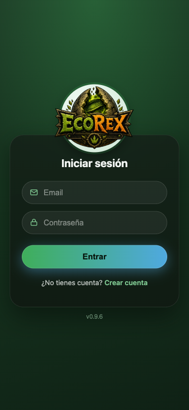<br><b>Entrada</b></td>
    <td align="center">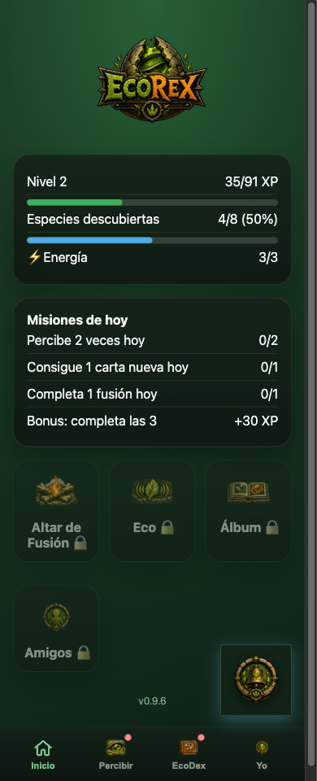<br><b>Inicio</b> — nivel, energía y misiones</td>
    <td align="center">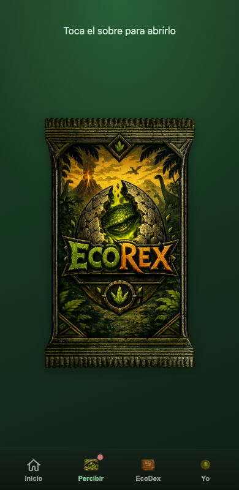<br><b>Percibir</b> — el sobre</td>
  </tr>
  <tr>
    <td align="center">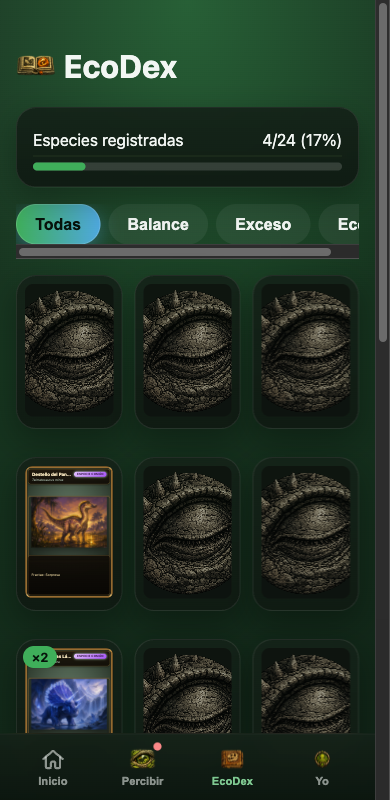<br><b>EcoDex</b> — la colección</td>
    <td align="center">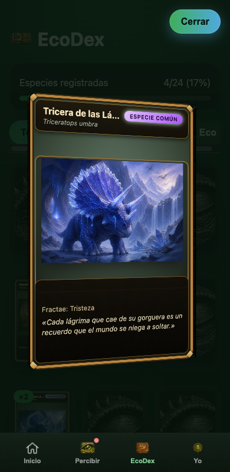<br><b>La carta</b> — por capas, con lore</td>
    <td align="center">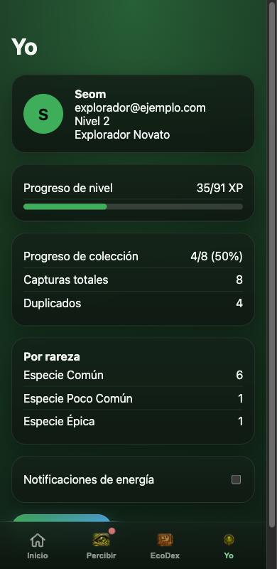<br><b>Perfil</b> — progreso y rarezas</td>
  </tr>
</table>

---

## 🦖 Pipeline de arte

El cuello de botella real del proyecto no es el código, es el **arte curado**: hay **54 fichas-spec** diseñadas y **6 especies** con arte final en producción.

1. **Ficha-spec de la especie**, generada con un LLM pero **contrastada con datos paleontológicos reales** para que no invente anatomía ni hábitat: el catálogo NHM Dino Directory, dinosaurpictures.org y la Paleobiology Database (taxonomía, rango temporal, países con yacimientos, validez/sinonimias).
2. **Imagen ancla de la fase Balance**, curada a mano.
3. **Exceso y Eco**, generadas por API (image-to-image) a partir de la ancla. Lo que más costó afinar fueron la relación figura/fondo y la diferenciación de pose entre fases, y por eso el prompt lleva un «anclaje anatómico» explícito.
4. **Conversión a WebP** y alta en la base de datos con `db:sync-species`.

Para explorar candidatos hay una herramienta local, `npm run species:discover`, que consulta PBDB con filtros por clado, época, país y número de ocurrencias, y muestra una recreación de referencia antes de decidir. Los borradores de diseño nunca se sirven en la app: solo `public/species-art/{slug}/{balance|exceso|eco}` llega a producción.

---

## 🧪 Cómo se prueba

**172 tests automáticos** (Vitest + Testing Library, en 32 ficheros) que cubren componentes de React, funciones de la API y la lógica del Worker de push (`selectUsersToNotify`). `npm run build` ejecuta además el typecheck de la app y de las Functions antes de empaquetar.

Lo que **no** cubren los tests automáticos y cómo se gestiona:

- **No hay tests E2E ni de regresión visual.** Los gestos y animaciones de la carta (`CardScene`) se prueban a nivel de comportamiento (por ejemplo, la reactividad del aura), no de píxeles.
- **Los problemas específicos de iOS** (menú contextual, autoplay, safe areas) quedan fuera de la suite: jsdom no los reproduce.
- **El estado de la base de datos remota** no lo cubre ninguna suite: lo vigila el comprobador de esquema (`npm run db:check-remote-schema`), que conviene ejecutar antes de cada despliegue que toque `schema.sql`.

---

## 🎯 Decisiones de diseño

**La energía es parte del juego, no solo una protección.** El rate-limit silencioso por IP se sustituyó por un recurso visible, con cuenta atrás y avisos. Sigue protegiendo el gasto de API, pero ahora es algo que el jugador gestiona.

**Rareza y fase son ejes independientes.** Una especie no tiene una rareza fija: se sortea en cada captura. La matriz de 5 rarezas × 3 fases da 15 estados por especie, y por eso las columnas de rareza no existen en `species` ni en `species_phase_anchors`.

**Fusionar consume, no borra.** Las 5 cartas Balance usadas quedan marcadas como consumidas (`consumed_at`): se conserva el historial de esa captura pero dejan de contar como duplicado activo. La fusión no cuesta energía; su único coste es haber acumulado los duplicados.

**Solo lo nuevo da XP.** Recompensar lo repetido incentiva farmear en lugar de explorar, así que los duplicados dan 0.

**Sin email-gate.** El prototipo pedía el correo tras el descubrimiento. Con cuentas reales, el correo se captura en el registro y no hace falta bloquear nada detrás de él.

**El esquema es la fuente de verdad, y remoto no se actualiza solo.** `schema.sql` define la base de datos; la D1 de producción solo tiene lo que se le haya aplicado a mano. Por eso hay un comprobador, y por eso nunca se re-ejecuta el esquema completo contra una base con datos: se aplica solo el delta.

**El arte final y los borradores no se mezclan.** Viven en carpetas distintas (`public/species-art/` frente a `especies_design/`, que no se versiona), de modo que un borrador no pueda llegar a producción por accidente.

---

## 📁 Estructura del repositorio

```
EcoRex/
├── src/                         # Frontend React
│   ├── pages/                   # Inicio, Percibir, Colección (EcoDex), Perfil, Fusión, Login/Registro
│   ├── components/              # Navegación, ritual de Percibir, misiones, subida de nivel, push
│   │   └── card/                # Card.tsx (capas) + CardScene.tsx (gestos)
│   └── sw.ts                    # Service worker (precache + eventos push)
├── functions/                   # Cloudflare Pages Functions (backend)
│   ├── api/                     # auth, discover, collection, fuse, energy, missions, notifications, push, profile, species
│   └── lib/                     # xp, energy, missions, discovery, rate limit, R2, proveedores de imagen/texto
├── workers/push-cron/           # Worker independiente con Cron Trigger (Web Push de energía)
├── shared/                      # Tipos y validaciones compartidas entre frontend y backend
├── schema.sql                   # Esquema D1, fuente de verdad de la base de datos
├── scripts/                     # Seed, sync de especies, generación de arte/specs, discovery PBDB, comprobador de esquema remoto
├── public/                      # Estáticos servidos: species-art, icons, logo, sonidos
├── design/                      # Material de diseño: badges de Fractae y fases, botones, cartas
└── docs/
    ├── lore_world_bible_ecorex_v5.md   # Biblia del universo y mapeo lore → implementación
    ├── backlog.md                       # Ideas sin priorizar
    └── archive/                         # Versiones anteriores del lore
```

---

## 🕓 Historial de versiones

| Versión | Novedades |
|---|---|
| v0.1.0 | Bucle central: Percibir, colección, fusión a Exceso, cuentas, notificaciones; correcciones móviles de iOS |
| v0.2.0 – v0.2.1 | Rediseño móvil, apertura de sobre inmersiva, PWA con iconos reales; renombrado Furia → Exceso y migración remota |
| v0.3.0 | XP y niveles 1–50, nombres de usuario únicos y obligatorios, ritual de subida de nivel |
| v0.4.0 – v0.4.5 | Navegación inferior, energía visible, deslizar hacia arriba para enviar al EcoDex, badges de navegación, pantalla completa de Level Up |
| v0.5.0 | Rebalanceo de XP y niveles; recompensas por nivel (energía máxima, umbral de fusión) |
| v0.6.0 | Misiones diarias, títulos de nivel, nombres de rareza estándar |
| v0.7.0 | Carta por capas (`Card` + `CardScene`) con lore real por especie |
| v0.8.0 | Rediseño del EcoDex con cartas a escala, arte en WebP (~90 % menos), cabeceras de caché, energía por goteo (+1 cada 4 h), lore por fase |
| v0.9.0 | Notificaciones Web Push (Worker con Cron Trigger), opt-in en la home y en el perfil |
| v0.9.5 | Notificación por cada punto de energía regenerado, reflejada también en la bandeja in-app |
| v0.9.6 | Mensaje de error más claro para fallos no controlados de la API |

Detalle de cada versión: [GitHub Releases](https://github.com/SamBarrado/EcoRex/releases).

---

## 🚫 Ideas pendientes y decisiones descartadas

*Decidir no construir algo es tan decisión de producto como construirlo.*

**Descartado**
- **Email-gate tras el descubrimiento:** innecesario con cuentas reales (ver «Decisiones de diseño»).
- **React Native:** descartado; si hace falta tienda de aplicaciones, la vía es envolver la misma build con Capacitor.

**Fuera de alcance por ahora**
- **Fase Eco:** el dato y el arte existen, pero no hay camino de progresión en la interfaz. Hoy el juego solo llega hasta Exceso (el diseño la reserva a un minijuego de grietas).
- **Regalo entre usuarios, lista de amigos y leaderboards:** el esquema ya lo contempla (`gifts`), pero no hay endpoint.
- **Cartas de Resonancia y Operaciones temáticas** con su propia distribución de rareza.
- **Verificación de email, recuperación de contraseña y login social.**

**Backlog** ([docs/backlog.md](docs/backlog.md)): pesos de aparición por especie, ediciones para colecciones tipo sobre, misiones semanales y rachas, rehacer el sistema de sonido, modo álbum con ilustraciones grandes, y distinguir «especie» de «variante» en la interfaz.

---

## ⚙️ Ejecutarlo en local

```bash
npm install
npm run dev            # typecheck + build + wrangler pages dev (frontend + Functions + D1/KV locales)
npm run vite:dev       # solo Vite, sin Functions
npm run build          # typecheck de app y Functions + vite build
npm test               # vitest run
npm run typecheck      # solo tsc
npm run db:seed        # siembra rarezas, Fractae y especies en la D1 local
```

Antes del primer `db:seed`, crea las tablas con `npx wrangler d1 execute DB --local --file=schema.sql` (el seed por sí solo falla con `no such table`). Para empezar de cero en local basta con borrar `.wrangler/state/v3/d1` y repetir esos dos pasos; nunca hagas el equivalente contra la D1 remota.

Copia `.dev.vars.example` a `.dev.vars` y rellena `ANTHROPIC_API_KEY` y `OPENAI_API_KEY`: son las claves de los proveedores de IA que usa el pipeline de contenido y los endpoints que generan imágenes, y no se incluyen en el repo. `DISCOVER_RATE_LIMIT` es opcional y solo para pruebas locales.

> **Local y producción son bases de datos distintas.** `wrangler pages dev` usa una copia local de D1 y KV bajo `.wrangler/state/`, aislada de los recursos reales. Los usuarios y el progreso creados en local no existen en producción, y un cambio en `schema.sql` no llega solo a la D1 remota. Antes de desplegar si tocaste el esquema, ejecuta `npm run db:check-remote-schema`.

**Worker de push.** `workers/push-cron` es un proyecto Wrangler independiente (con su propio `npm install`, su propio estado local de D1 y sus propios secrets), y **no se despliega con el push a `main`**: se despliega aparte con `npm run deploy` dentro de su carpeta.

### Desplegar tu propia copia

1. Crea los recursos: `npx wrangler d1 create ecorex-db`, `npx wrangler kv namespace create RATE_LIMIT_KV`, y `npx wrangler r2 bucket create ecorex-dino-images`; copia los IDs resultantes a `wrangler.jsonc` (y el `database_id` a `workers/push-cron/wrangler.jsonc`).
2. Aplica el esquema a la D1 remota una sola vez: `npx wrangler d1 execute DB --remote --file=schema.sql`, y siembra con `npm run db:seed:remote`.
3. Crea el proyecto de Pages y conecta el repositorio (rama `main`): cada push construye y despliega.
4. Genera un par de claves VAPID y guárdalas como secrets, tanto del proyecto Pages (`wrangler pages secret put`) como del Worker (`wrangler secret put`, dentro de `workers/push-cron/`): `VAPID_PUBLIC_KEY` y `VAPID_PRIVATE_KEY`. Añade también `ANTHROPIC_API_KEY` y `OPENAI_API_KEY` al proyecto Pages.
5. Despliega el Worker de push: `cd workers/push-cron && npm install && npm run deploy`.

---

## 🔗 Repositorio

[github.com/SamBarrado/EcoRex](https://github.com/SamBarrado/EcoRex) · Prototipo precursor: [Dino Discovery](https://github.com/SamBarrado/DinoDiscovery)

---

¿Has encontrado un bug o tienes una idea? [Abre una issue](https://github.com/SamBarrado/EcoRex/issues).
