**EN** | [ES](README.es.md)

<p align="center">
  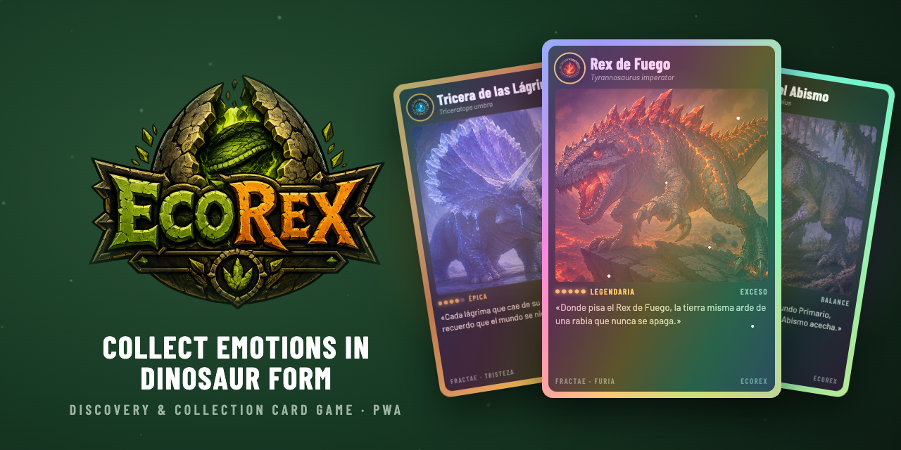
</p>

# Ecorex — Collect Emotions in Dinosaur Form
### Discovery & collection PWA game | React · TypeScript · Cloudflare Pages/D1 · Web Push

[](https://ecorex-project.pages.dev)
[](https://github.com/SamBarrado/EcoRex/releases)
[](https://github.com/SamBarrado/EcoRex/commits/main)

Ecorex is an installable web game (PWA) where the player **perceives** dinosaurs that are really the bodies taken by eight primal emotions, trapped since the extinction. Every discovery is a **collectible card** with its species, its emotion (a *Fractae*), its rarity and its phase. Duplicate cards are **fused** at the Altar into the overflowing version of the creature, and everything feeds XP, levels and daily missions.

<table>
  <tr>
    <td align="center">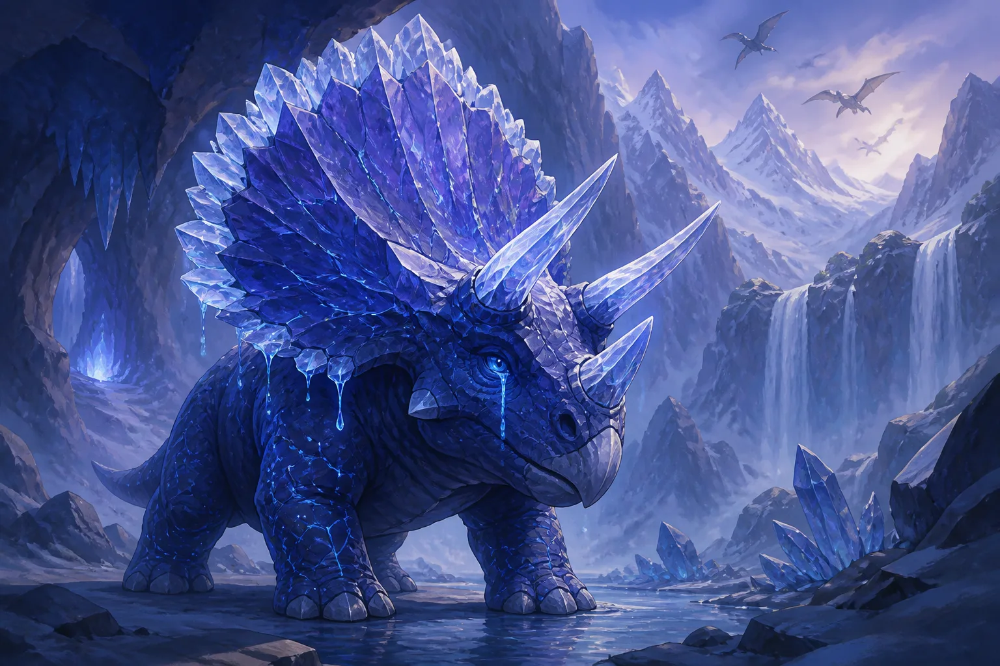<br><b>Balance</b> — stable form</td>
    <td align="center">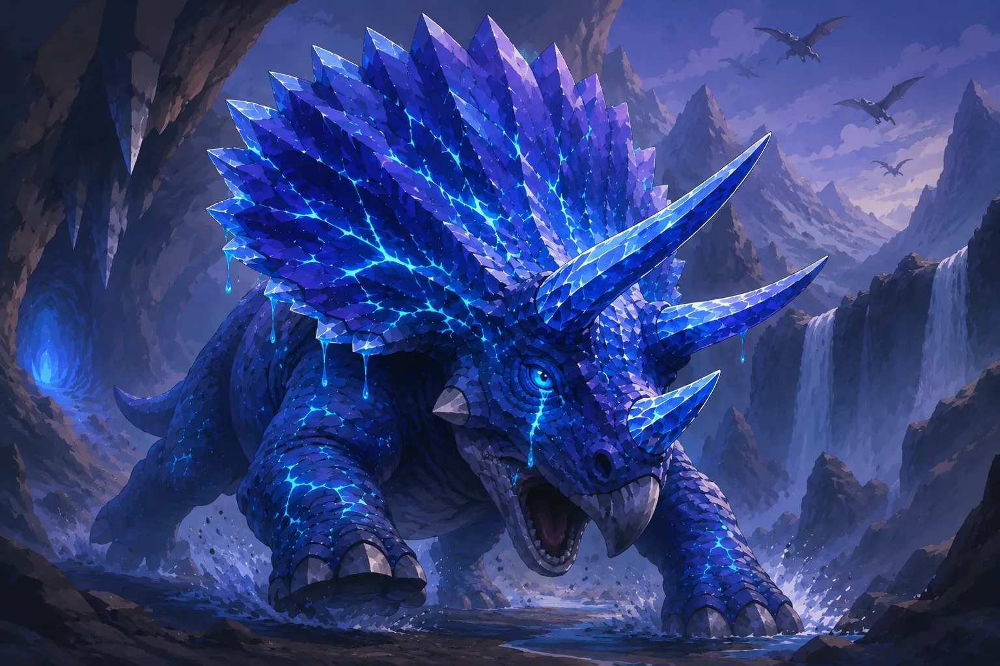<br><b>Exceso</b> (Excess) — overflowing form</td>
    <td align="center">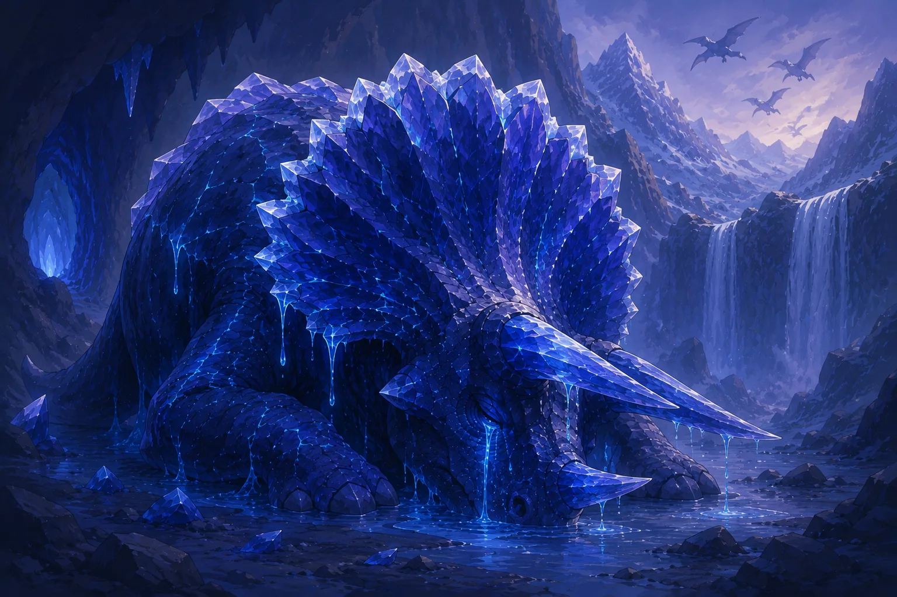<br><b>Eco</b> (Echo) — faded version</td>
  </tr>
</table>

*The three phases of one species: **Triceratops umbra**, "Tricera de las Lágrimas" (Tricera of Tears), Fractae Sadness.*

**Play:** [ecorex-project.pages.dev](https://ecorex-project.pages.dev) *(the app's interface is in Spanish)*

This README documents the project as a **product and engineering case study**: what was built, which real problems showed up along the way, and why each design decision was made — at the level of detail someone picking up this code cold would need.

---

## 🚀 Quick start

```bash
git clone https://github.com/SamBarrado/EcoRex.git
cd EcoRex
npm install
cp .dev.vars.example .dev.vars   # and fill in your own keys (they are not in the repo)
npm run db:migrate                                     # create the tables in the local D1 (applies migrations/)
npm run db:seed                                        # seed rarities, Fractae and species
npm run dev                      # build + wrangler pages dev: frontend + Functions + local D1/KV
```

`npm run vite:dev` starts the frontend alone: screens render, but anything touching accounts, the collection or energy needs the Functions and the local D1. For the full guide (and to deploy your own copy) see "⚙️ Running it locally" below.

---

## 💡 Where the idea came from

Ecorex grew out of an earlier prototype, [Dino Discovery](https://github.com/SamBarrado/DinoDiscovery): an app where a kid invents their own dinosaur by picking attributes and gets back an AI-generated card. What came out of it was the realization that the valuable part wasn't "generating an image" but **finding a collectible object**. Ecorex takes that idea to a persistent game with accounts, a fixed species catalog and progression, and reuses the prototype's battle-tested infrastructure layer (rate limiting, cache, R2, origin validation).

The narrative premise is what sets Ecorex apart:

> 66 million years ago, the impact that wiped out the dinosaurs produced the largest discharge of collective emotional trauma in the planet's history. That emotion didn't dissipate: it stayed trapped, fragmented, dormant — like fossils, but emotional. Something recent has cracked that barrier open again.

The **Fractae** are those pure emotions. They aren't creatures on their own: they need a carrier, and the only carrier is the dinosaur. The player isn't a scientist but someone sensitive enough to **perceive** what others can't see.

<p align="center">
  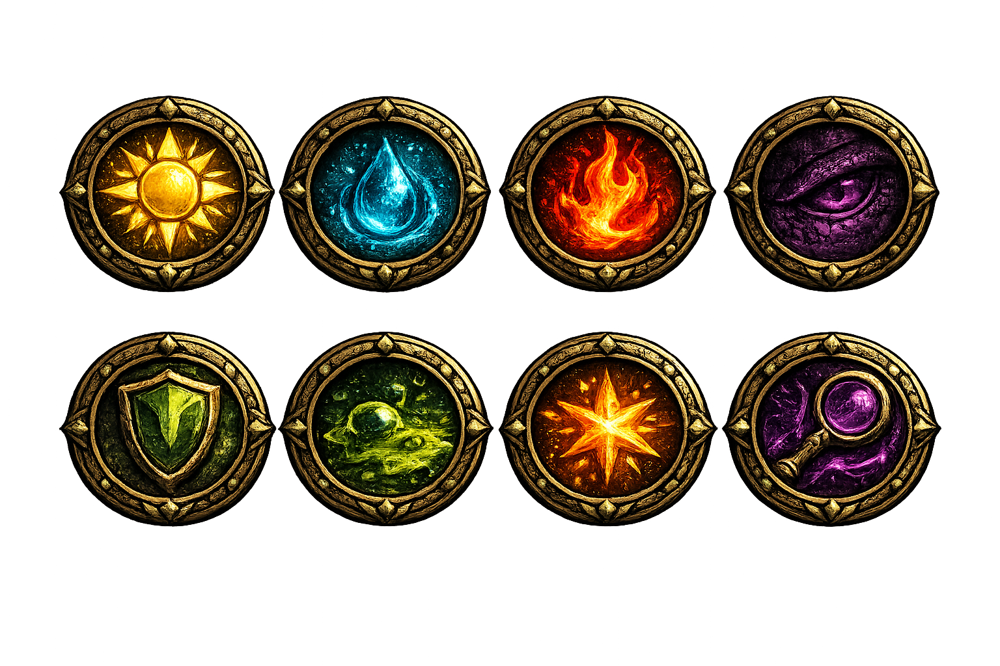
</p>

Eight Fractae (Joy, Sadness, Fury, Fear, Trust, Disgust, Surprise, Curiosity), arranged in four oppositions. The full universe design lives in [docs/lore_world_bible_ecorex_v5.md](docs/lore_world_bible_ecorex_v5.md) *(in Spanish)*.

---

## 🧒 Who it's for

Kids who like dinosaurs and Pokémon-style collectible games. One early design decision: **the account holder is the kid themselves**, not a guardian managing the account on their behalf (direct sign-up, no "parent/child" profile layer), and the founding myth is written to work as-is from age 5, without softening it. The tone is about collecting and discovering, not generating.

---

## 🎮 How it plays

| System | What it does |
|---|---|
| **Percibir** (Perceive) | The discovery ritual: a full-screen pack you tear open by dragging along its seam, with haptic feedback where the device supports it. Rolls the card's rarity independently from species and phase. |
| **Energy** | Perceiving costs energy, shown in the navigation. Base of 3, regenerating **+1 every 4 h**, and raised by level (+1 at level 5, +1 at level 30). It replaced a silent per-IP rate limit. |
| **EcoDex** | The collection: every species has 3 phases (Balance, Exceso, Eco). Progress is counted in *registries* (a species+phase obtained at least once), separately from species and cards, and only playable species count. Discovered phases render as mini cards (rarity-coloured frame, art, readable name and rarity), with a full-screen viewer. |
| **Altar de Fusión** (Fusion Altar) | 5 duplicate Balance cards of a species are consumed to obtain its **Exceso** card (4 from level 15). It costs no energy. |
| **Eco** | A rare drop of Percibir (5 %): the faded, extreme echo of a species whose Balance you already own, so it is never the first card of a species. The server decides it (the client can't ask for it) and a repeated Eco has no use. Completing a species' three phases pays a bonus. |
| **Rarity** | Five tiers — Common, Uncommon, Rare, Epic, Legendary — with drop weights of 55 / 27 / 12 / 5 / 1 %. An axis independent from phase. |
| **XP and levels** | Levels 1–50 from accumulated XP. Only what's new gives XP (a species+phase seen for the first time, fusions, completing a species' 3 phases): repeating gives nothing. Eight cosmetic titles, from "Explorador Novato" (Novice Explorer) to "Voz de la Fractura" (Voice of the Fracture). |
| **Daily missions** | Three daily missions (Percibir, Collect 3 cards, and Fusion as an optional extra) plus a bonus for completing the two main ones the same day. A **daily streak** (consecutive days with any activity) pays XP and an energy refill at 3 days, 7 days and every 7 after. Both main missions fit the base daily energy budget, so they stay completable even once the catalog is fully collected. The day rolls over at midnight in Spain. |
| **Notifications** | An in-app inbox with navigation badges, and **Web Push** (works with the PWA closed) every time a point of energy regenerates. |

<p align="center">
  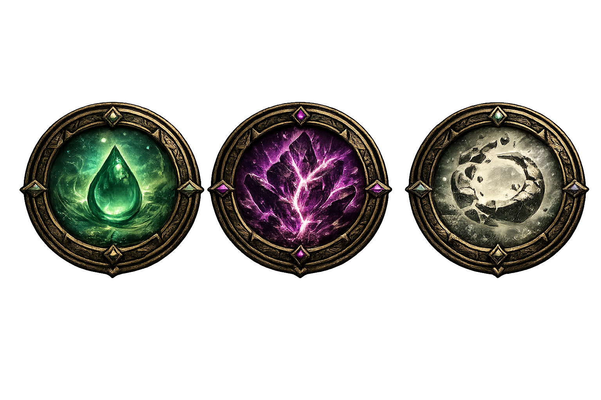
</p>

---

## 🛠️ Tools and technologies

| Layer | Choice | Why |
|---|---|---|
| **Frontend** | React 19 + React Router 7 + TypeScript + Vite | Fast dev loop |
| **PWA** | `vite-plugin-pwa` (`injectManifest`) + custom service worker | Installable on mobile without an app store; the custom SW handles push events. If a store ever becomes necessary, the path is wrapping the same build with Capacitor |
| **Backend** | Cloudflare Pages Functions (`functions/api/**`) | Deploys alongside the frontend, no separate API host to maintain |
| **Database** | Cloudflare D1 (SQLite) — schema as numbered [migrations](migrations/) | Relational data (users, collection, missions, notifications) with no database server to operate |
| **Storage / cache** | Pages static assets (species art) + KV (rate limiting) | Serverless and free at current volume |
| **Push** | Web Push (VAPID) with `@block65/webcrypto-web-push` + a **standalone Worker with a Cron Trigger** (`workers/push-cron`) | Pages Functions don't support Cron Triggers |
| **Content generation** | Anthropic and OpenAI APIs (species spec sheets; art and phases) | Content production pipeline, see "Art pipeline" |
| **Testing** | Vitest + Testing Library + jsdom | One tool for components, API functions and the Worker |
| **Deploy** | Cloudflare Pages connected to GitHub | Every push to `main` builds and deploys to production |

---

## 🐛 Technical problems solved

Not a feature list, but a "what actually went wrong and how it got fixed" list:

- **Production data fell behind the schema.** The remote D1 lacked the `consumed_at` column and the `notifications` table that `schema.sql` did define, and it only surfaced while migrating an account to production. That led first to a checker script and then to numbered D1 migrations (`migrations/`, applied with `wrangler d1 migrations`): the database records which ones it already has, so `npm run db:migrate:status` shows what is pending and nothing can silently fall behind.
- **A phase name collided with a Fractae.** The middle phase was called "Furia" (Fury), the same as the Fractae Furia (Ira): a Fear creature in the "Furia" phase sounded like a Fury creature. It was renamed **Exceso** (Excess), which meant touching the schema `CHECK`, the code, the file names and — with a dedicated migration script — the rows already in the production D1.
- **Fusing made cards vanish from the EcoDex.** Because fusion *consumes* the Balance duplicates, an EcoDex based on active rows lost that phase or replayed the "new species" animation when it was obtained again. The correct rule is to rely on the **historical** existence of any discovery of that species+phase.
- **A field stored a snapshot, not a reference.** `discoveries.image_url` is a per-user copy fixed at discovery time, not a live link to the anchors table. Migrating the art from PNG to WebP meant migrating user rows too (local and remote); on top of that, the seed uses `INSERT OR IGNORE`, which doesn't propagate changes to already-seeded rows.
- **Art weighed 2.5 MB per image.** Switched to WebP (~90 % smaller, ~0.2 MB), with one-year `immutable` cache headers and lazy loading for off-screen cards. The trade-off is documented: without a hash in the file name, regenerating art under the same name wouldn't reload in browsers for a year.
- **iOS Safari broke the ritual on mobile.** The long-press context menu interrupted the "hold to discover" gesture; the autoplay policy silently blocked species sounds; the bottom bar covered content on notched devices; and pull-to-refresh interfered with gestures.
- **Push notifications couldn't live in Pages Functions.** A separate Worker with a 15-minute Cron Trigger was needed. Along the way: one invalid subscription aborted the whole loop for every other user; `webcrypto-web-push` needs `nodejs_compat` because of its `node:crypto` import; and the Worker's max energy had to be computed **per user from their level**, since the cap isn't the same for everyone.
- **The XP curve rewarded farming and made the max level unreachable.** Duplicates gave XP, and the initial triangular curve put level 50 at ~2.6 years of play. It was rebalanced: repeats give 0 XP, the curve is flatter, and the max level is reachable in ~4–5 months of active play.
- **Importing a script ran it in full.** `generate-species-art.mjs` launched a real generation, with API cost, on species nobody had asked for when imported from another script. Its `main()` is now protected by an `import.meta.url` guard.

---

## 🏗️ How it was built

### Phase 1 — The core loop (v0.1)

Accounts (email + password with PBKDF2, `HttpOnly` cookie sessions), **Percibir** to get Balance cards, **Fusion** of duplicates towards Exceso, and notifications. Plus the first batch of mobile fixes for iOS.

### Phase 2 — Mobile and immersion (v0.2)

Mobile redesign: logo, game modes, a floating button for profile and notifications, a CSS-only particle background and Percibir's full-screen pack. It is also the version of the Furia → Exceso rename and its production data migration.

### Phase 3 — Progression (v0.3 – v0.6)

XP and levels 1–50, unique required usernames, a persistent bottom navigation with badges, **visible energy** (which replaced the silent rate limit), a swipe-up gesture to send the card to the EcoDex, a level-up screen, a curve rebalance with level-based rewards, daily missions, level titles and standard rarity names.

### Phase 4 — The card as an object (v0.7 – v0.8)

The Percibir card went from an image with text to a layered composition: background, rarity aura, art window, Fractae medallion, name plate with common and scientific name, lore box, ornamented border and a textured edge. It was split into `Card.tsx` (presentation) and `CardScene.tsx` (gestures: inertial spin, flip, swipe up), with real lore phrases per species and per phase. The EcoDex was rebuilt with scaled cards instead of thumbnails, and energy went from a flat reset every 12 h to a +1-every-4-h drip.

The card was then redesigned ("Foil"): a frame whose material follows the rarity (graphite, silver, holographic, gold, prismatic) with foil and glare that follow the card's angle, a solid rounded edge, a mystery reveal (the back is uncovered by a line of light, with rings and particles that scale with rarity) and a card that levitates over a surface, its shadow marking the height. The EcoDex tile became a small card of its own instead of a shrunken copy.

### Phase 5 — Push notifications (v0.9)

Web Push subscription with opt-in (an onboarding tile and a toggle in the profile), a Worker with a Cron Trigger that notifies **for every point of energy regenerated** — not just on reaching the max — and the same notice mirrored in the in-app inbox.

---

## 📸 Screenshots

Real screenshots of the app in production (v0.9.6), taken with a test account.

<table>
  <tr>
    <td align="center">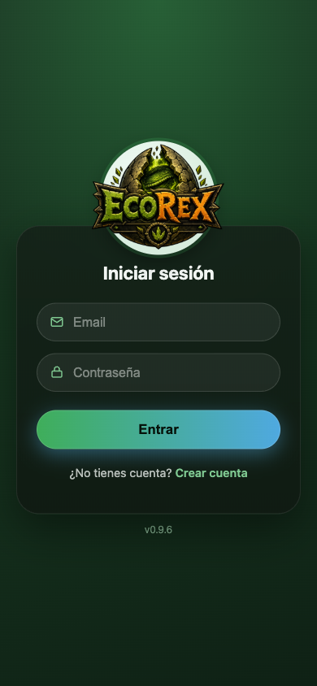<br><b>Sign in</b></td>
    <td align="center">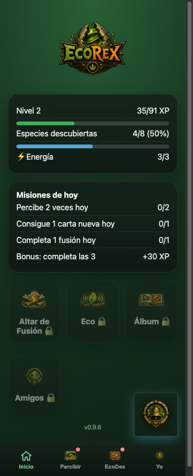<br><b>Home</b> — level, energy and missions</td>
    <td align="center">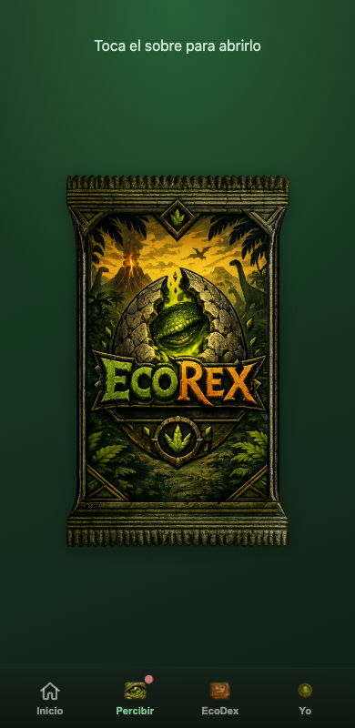<br><b>Percibir</b> — the pack</td>
  </tr>
  <tr>
    <td align="center">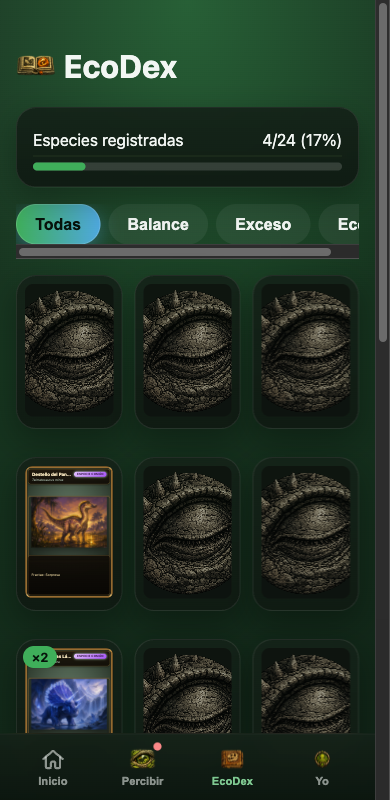<br><b>EcoDex</b> — the collection</td>
    <td align="center">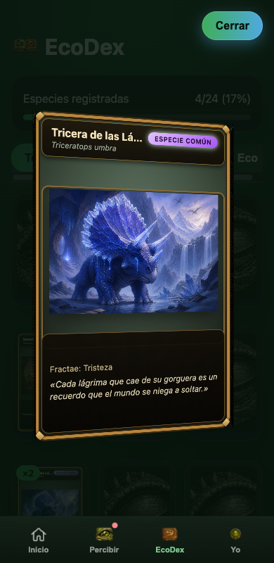<br><b>The card</b> — layered, with lore</td>
    <td align="center">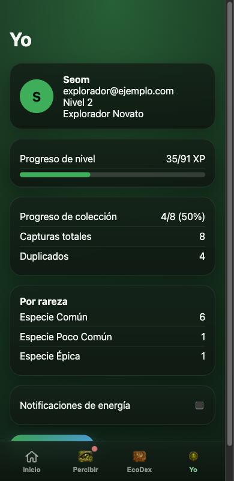<br><b>Profile</b> — progress and rarities</td>
  </tr>
</table>

---

## 🦖 Art pipeline

The project's real bottleneck isn't code, it's **curated art**: there are **54 spec sheets** designed and **6 species** with final art in production.

1. **Species spec sheet**, generated with an LLM but **cross-checked against real paleontological data** so it doesn't invent anatomy or habitat: the NHM Dino Directory catalog, dinosaurpictures.org and the Paleobiology Database (taxonomy, time range, countries with fossil sites, validity/synonymy).
2. **Balance-phase anchor image**, hand-curated.
3. **Exceso and Eco**, generated via API (image-to-image) from the anchor. The hardest things to tune were the figure/ground relationship and pose differentiation between phases, which is why the prompt carries an explicit "anatomy anchor".
4. **WebP conversion** and database registration with `db:sync-species`.


---

## 🧪 How it's tested

**172 automated tests** (Vitest + Testing Library, across 32 files) covering React components, API functions and the push Worker's logic (`selectUsersToNotify`). `npm run build` also runs the app and Functions typecheck before bundling.

What the automated tests **don't** cover, and how that's handled:

- **There are no E2E or visual-regression tests.** The card's gestures and animations (`CardScene`) are tested at the behavior level (for example, that the reveal starts covered by the back and that a drag springs onto the nearest face), not at the pixel level.
- **iOS-specific problems** (context menu, autoplay, safe areas) fall outside the suite: jsdom doesn't reproduce them.
- **The remote database state** isn't covered by any suite: `npm run db:migrate:status` lists the pending migrations on local and remote, and it's worth running before any deploy that adds one.

---

## 🎯 Design decisions

**Energy is part of the game, not just a safeguard.** The silent per-IP rate limit was replaced by a visible resource, with a countdown and notifications. It still protects API spend, but now it's something the player manages.

**Rarity and phase are independent axes.** A species has no fixed rarity: it's rolled on every capture. The 5 rarities × 3 phases matrix gives 15 states per species, which is why rarity columns don't exist in `species` or `species_phase_anchors`.

**Fusing consumes, it doesn't delete.** The 5 Balance cards used are marked as consumed (`consumed_at`): the history of that capture is kept but they no longer count as active duplicates. Fusion costs no energy; its only cost is having accumulated the duplicates.

**Only what's new gives XP.** Rewarding repeats encourages farming over exploring, so duplicates give 0.

**No email gate.** The prototype asked for the email after the discovery. With real accounts, the email is captured at sign-up and nothing needs to be blocked behind it.

**Numbered migrations are the source of truth, and remote doesn't update itself.** `migrations/0001_baseline.sql` is a snapshot of production (verified column by column against the live database before being marked as applied there); every later change is a new numbered file. Applying is always explicit (`npm run db:migrate` locally, `npm run db:migrate:remote` for production) and each database records what it already has, so a migration never runs twice.

**Final art and drafts don't mix.** They live in different folders (`public/species-art/` versus `especies_design/`, which isn't versioned), so a draft can't reach production by accident.

---

## 📁 Repository structure

```
EcoRex/
├── src/                         # React frontend
│   ├── pages/                   # Home, Percibir, Collection (EcoDex), Profile, Fusion, Login/Register
│   ├── components/              # Navigation, Percibir ritual, missions, level-up, push
│   │   └── card/                # Card.tsx (the 3D object) + CardScene.tsx (reveal, spin, levitation)
│   └── sw.ts                    # Service worker (precache + push events)
├── functions/                   # Cloudflare Pages Functions (backend)
│   ├── api/                     # auth, discover, collection, fuse, energy, missions, notifications, push, profile, species
│   └── lib/                     # xp, energy, missions, discovery, rate limit
├── admin/                       # Ecorex Admin: private console, its own Pages project (own build, Functions and wrangler config) — see docs/ECOREX_ADMIN_ARCHITECTURE.md
├── workers/push-cron/           # Standalone Worker with a Cron Trigger (energy Web Push)
├── migrations/                  # Numbered D1 migrations (0001_baseline = production snapshot): the database's source of truth
├── scripts/                     # DB seed data (seed.sql)
├── tools/                       # Local-only content pipeline (never deployed): species spec/art generation, PBDB discovery, species sync, avatars — see tools/species/README.md
├── public/                      # Served statics: species-art, icons, logo, sounds
├── design/                      # Design material: Fractae and phase badges, buttons, cards
└── docs/
    ├── lore_world_bible_ecorex_v7.md   # Universe bible and lore → implementation mapping (Spanish)
    ├── backlog.md                       # Unprioritized ideas (Spanish)
    ├── screenshots/                     # Images used in this README
    └── archive/                         # Earlier lore versions
```

---

## 🕓 Version history

| Version | Highlights |
|---|---|
| v0.1.0 | Core loop: Percibir, collection, fusion to Exceso, accounts, notifications; iOS mobile fixes |
| v0.2.0 – v0.2.1 | Mobile redesign, immersive pack opening, PWA with real icons; Furia → Exceso rename and remote migration |
| v0.3.0 | XP and levels 1–50, unique required usernames, level-up ritual |
| v0.4.0 – v0.4.5 | Bottom navigation, visible energy, swipe up to send to the EcoDex, navigation badges, full-screen Level Up |
| v0.5.0 | XP and level rebalance; level-based rewards (max energy, fusion threshold) |
| v0.6.0 | Daily missions, level titles, standard rarity names |
| v0.7.0 | Layered card (`Card` + `CardScene`) with real per-species lore |
| v0.8.0 | EcoDex redesign with scaled cards, WebP art (~90 % smaller), cache headers, drip energy (+1 every 4 h), per-phase lore |
| v0.9.0 | Web Push notifications (Worker with a Cron Trigger), opt-in on home and profile |
| v0.9.5 | A notification for every point of energy regenerated, also mirrored in the in-app inbox |
| v0.9.6 | Clearer error message for unhandled API failures |
| v0.10.0 | Card redesign (Foil frame by rarity, mystery reveal, spring spin, levitation) and a new EcoDex tile, default profile avatars, numbered D1 migrations, codebase cleanup |

Detail for each version: [GitHub Releases](https://github.com/SamBarrado/EcoRex/releases).

---

## 🚫 Pending ideas and discarded decisions

*Deciding not to build something is as much a product decision as building it.*

**Discarded**
- **Email gate after the discovery:** unnecessary with real accounts (see "Design decisions").
- **React Native:** discarded; if an app store becomes necessary, the path is wrapping the same build with Capacitor.

**Out of scope for now**
- **Gifting between users, friends list and leaderboards:** the schema already allows for it (`gifts`), but there's no endpoint.
- **Resonance Cards and themed Operations** with their own rarity distribution.
- **Email verification and email-based password recovery.** Google sign-in exists instead (see CLAUDE.md); Google-linked accounts have no password, so Google handles their recovery.

**Backlog** ([docs/backlog.md](docs/backlog.md), in Spanish): a retention analysis with prioritised quick wins (streaks, onboarding, fusion progress, the Eco drop), plus per-species appearance weights, editions for pack-style collections, reworking the sound system, an album mode with large illustrations, and distinguishing "species" from "variant" in the interface.

---

## ⚙️ Running it locally

```bash
npm install
npm run dev            # typecheck + build + wrangler pages dev (frontend + Functions + local D1/KV)
npm run vite:dev       # Vite only, no Functions
npm run build          # typecheck of app and Functions + vite build
npm test               # vitest run
npm run typecheck      # tsc only
npm run db:seed        # seeds rarities, Fractae and species into the local D1
```

Before the first `db:seed`, create the tables with `npm run db:migrate` (the seed alone fails with `no such table`). To start from scratch locally, just delete `.wrangler/state/v3/d1` and repeat those two steps. To change the schema: `npm run db:migrate:new -- <name>`, write the SQL in the new file, `npm run db:migrate`, and later `npm run db:migrate:remote`.

Copy `.dev.vars.example` to `.dev.vars` and fill in `ANTHROPIC_API_KEY` and `OPENAI_API_KEY`: they are the AI provider keys used by the local content pipeline (`tools/`) only — the app's endpoints do not call any AI provider at runtime — and they are not included in the repo. `DISCOVER_RATE_LIMIT` is optional and only for local testing.

> **Local and production are different databases.** `wrangler pages dev` uses a local copy of D1 and KV under `.wrangler/state/`, isolated from the real resources. Users and progress created locally don't exist in production, and a migration applied locally doesn't reach the remote D1 on its own. Before deploying if you added one, run `npm run db:migrate:status`, then `npm run db:migrate:remote`.

**Push Worker.** `workers/push-cron` is a standalone Wrangler project (with its own `npm install`, its own local D1 state and its own secrets), and it is **not deployed by pushing to `main`**: it's deployed separately with `npm run deploy` inside its folder.

### Deploying your own copy

1. Create the resources: `npx wrangler d1 create ecorex-db`, `npx wrangler kv namespace create RATE_LIMIT_KV`; copy the resulting IDs into `wrangler.jsonc` (and the `database_id` into `workers/push-cron/wrangler.jsonc`).
2. Apply the migrations to the remote D1: `npm run db:migrate:remote`, and seed with `npm run db:seed:remote`.
3. Create the Pages project and connect the repository (branch `main`): every push builds and deploys.
4. Generate a VAPID key pair and store it as secrets, both for the Pages project (`wrangler pages secret put`) and for the Worker (`wrangler secret put`, inside `workers/push-cron/`): `VAPID_PUBLIC_KEY` and `VAPID_PRIVATE_KEY`. Also add `ANTHROPIC_API_KEY` and `OPENAI_API_KEY` to the Pages project.
5. Deploy the push Worker: `cd workers/push-cron && npm install && npm run deploy`.

---

## 🔗 Repository

[github.com/SamBarrado/EcoRex](https://github.com/SamBarrado/EcoRex) · Predecessor prototype: [Dino Discovery](https://github.com/SamBarrado/DinoDiscovery)

---

Found a bug or have an idea? [Open an issue](https://github.com/SamBarrado/EcoRex/issues).
